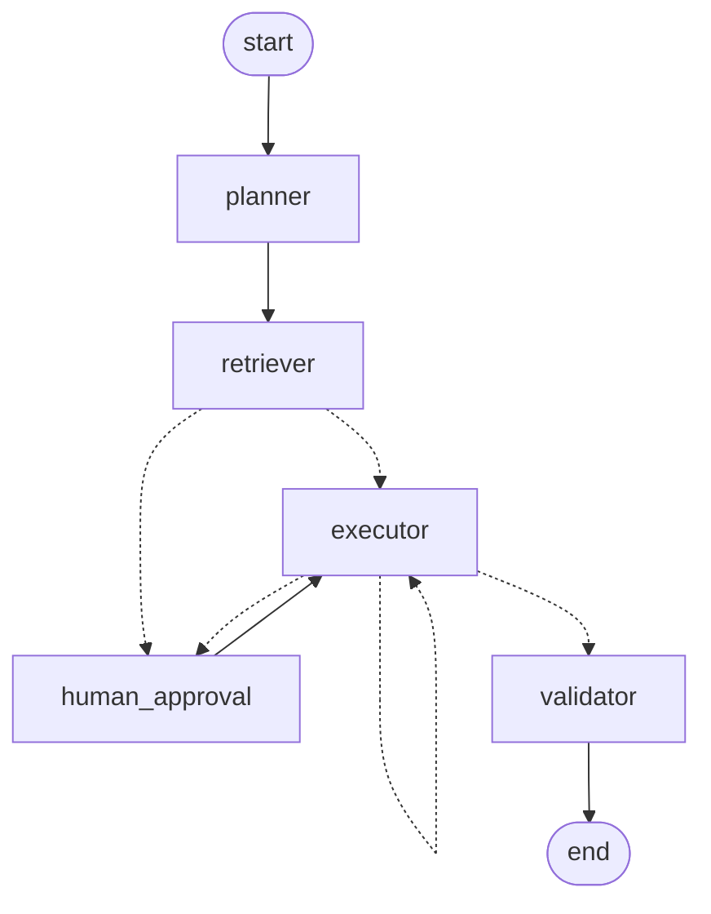

# Agentic AI Workflow Automation System

A multi-agent system built with **LangGraph** that turns a plain-English business request (for example, *"Onboard Ravi Kumar and give admin access to prod"*) into a plan, checks company policy, runs each step through internal tools, and **pauses for human approval** before any high-risk action.

**Stack:** Python · LangGraph · LangChain · FastAPI · Docker · AWS (deployment) · GitHub Actions



## How it works
| Agent | Job |
|---|---|
| **Planner** | Breaks the request into tool calls and tags each one low or high risk (LLM with structured output, or a rule-based planner when no API key is set) |
| **Retriever** | Pulls the company policies that apply to the planned actions |
| **Executor** | Runs one step at a time against the tools (accounts, access, equipment orders, email, meetings) |
| **Human approval** | A LangGraph `interrupt()` checkpoint. The run pauses, shows the reviewer the action and the policy, and resumes on approve or reject |
| **Validator** | Checks every step's outcome and sets the final status |

- **Conditional routing** decides after every step whether to run the next step, pause for approval, or finish
- **Shared state** (`WorkflowState`) carries the plan, policies, results and an audit log between agents
- **Checkpointing** saves state after every node, so a paused run can be resumed later through the API
- Rejected actions are never executed and are recorded in the audit log

## Quick start
```bash
python -m venv .venv && source .venv/bin/activate      # Windows: .venv\Scripts\activate
pip install -r requirements-dev.txt
uvicorn app.main:app --reload
```
Open http://localhost:8000/docs, or:
```bash
# 1. Start a workflow. It pauses at the admin-access step.
curl -X POST localhost:8000/workflows -H "Content-Type: application/json" \
     -d '{"request": "Onboard Ravi Kumar and give admin access to prod"}'

# 2. Approve it (use the run_id from step 1)
curl -X POST localhost:8000/workflows/<run_id>/approve -H "Content-Type: application/json" \
     -d '{"approved": true, "reviewer": "manager"}'
```
Set `OPENAI_API_KEY` in `.env` to let an LLM do the planning instead of the built-in rules.

## API
| Method | Path | Purpose |
|---|---|---|
| POST | `/workflows` | Start a run from a request |
| GET | `/workflows/{run_id}` | Plan, status, pending approval and audit log |
| POST | `/workflows/{run_id}/approve` | Approve or reject the paused step |
| GET | `/health` | Health check |

## Tests
```bash
pytest -q
```
The tests cover a full end-to-end run, pausing and resuming at a checkpoint, rejected actions, and error codes.

## Deploying to AWS
Build the Docker image, push it to Amazon ECR, and run it on ECS Fargate or App Runner. For multi-instance deployments, replace `MemorySaver` with a persistent checkpointer (Postgres or Redis) so paused runs survive restarts.
